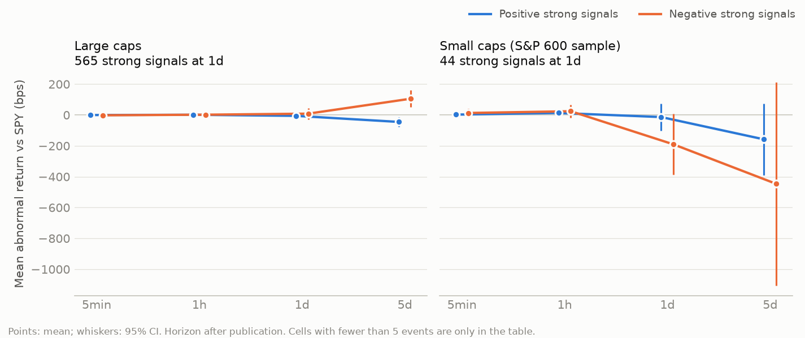

# Event study - 2026-10-23

**Hypothesis (registered 2026-09-26):** LLM news sentiment predicts abnormal returns (vs SPY) after publication, and the effect is larger for less-covered companies (random S&P SmallCap 600 sample) than for the most covered large caps.

**Window:** 2026-09-28 to 2026-10-15 · **Stopping rule:** 360/300 small-cap signals, 7 days to 2026-10-30 - REACHED

## Data

| Group | Signals used |
| --- | --- |
| Large caps | 9930 |
| Small caps (S&P 600 sample) | 360 |

Excluded before analysis: 0 not from the registered news source, 0 no source timestamp, 0 different LLM model, 0 ticker no longer in the watchlist.

| Horizon | ok | pending (window not over) | no price |
| --- | --- | --- | --- |
| 5min | 10290 | 0 | 0 |
| 1h | 10290 | 0 | 0 |
| 1d | 10290 | 0 | 0 |
| 5d | 10290 | 0 | 0 |

## Mean abnormal return of strong signals

| Horizon | Group | Direction | n | Mean (bps) | 95% CI (bps) | Windows with a trade |
| --- | --- | --- | --- | --- | --- | --- |
| 5min | Large caps | positive | 481 | -0.4 | -1.7 to 0.9 | 78% |
| 5min | Large caps | negative | 84 | -1.9 | -6.0 to 2.3 | 81% |
| 5min | Small caps (S&P 600 sample) | positive | 36 | 2.5 | -0.6 to 5.5 | 22% |
| 5min | Small caps (S&P 600 sample) | negative | 8 | 13.0 | -13.6 to 39.6 | 50% |
| 1h | Large caps | positive | 481 | 1.4 | -3.4 to 6.3 | 85% |
| 1h | Large caps | negative | 84 | 1.9 | -12.8 to 16.6 | 87% |
| 1h | Small caps (S&P 600 sample) | positive | 36 | 13.3 | -1.9 to 28.4 | 44% |
| 1h | Small caps (S&P 600 sample) | negative | 8 | 24.4 | -17.8 to 66.5 | 62% |
| 1d | Large caps | positive | 481 | -5.5 | -19.3 to 8.3 | 100% |
| 1d | Large caps | negative | 84 | 8.6 | -27.9 to 45.2 | 99% |
| 1d | Small caps (S&P 600 sample) | positive | 36 | -13.4 | -100.7 to 73.9 | 97% |
| 1d | Small caps (S&P 600 sample) | negative | 8 | -190.5 | -387.1 to 6.0 | 100% |
| 5d | Large caps | positive | 481 | -44.9 | -76.5 to -13.2 | 100% |
| 5d | Large caps | negative | 84 | 105.8 | 51.1 to 160.5 | 100% |
| 5d | Small caps (S&P 600 sample) | positive | 36 | -157.9 | -389.8 to 74.0 | 100% |
| 5d | Small caps (S&P 600 sample) | negative | 8 | -446.5 | -1105.0 to 212.0 | 100% |

## Primary test (1d)

OLS of the abnormal return (bps) on the signal score, with a score × small-cap interaction. n = 10290 events over G = 18 trading days. Each coefficient uses the largest of the classic, HC1 and day-clustered standard errors, with a t distribution on 17 degrees of freedom (conservative on purpose: clustered errors understate uncertainty when there are few trading days).

| Term | Estimate (bps) | 95% CI | p-value | SE used |
| --- | --- | --- | --- | --- |
| Intercept | -0.9 | -19.7 to 17.8 | 0.917 | clustered |
| Score (large caps) | 10.0 | -14.2 to 34.2 | 0.397 | clustered |
| Small cap | -37.4 | -112.4 to 37.6 | 0.307 | clustered |
| **Score × small cap** | -18.8 | -126.6 to 89.1 | 0.718 | HC1 |

The **score × small cap** row answers the hypothesis: how many extra basis points a one-unit change in sentiment moves a small cap, compared with a large cap.

## Method

- Price at time *t*: close of the last 1-minute bar that ended at or before *t* (a bar's close is only known when the bar ends).
- Abnormal return: stock return minus SPY return over the same window.
- 5min / 1h: wall-clock windows. 1d / 5d: same New York clock time N trading days later, with the calendar taken from SPY's regular sessions.
- Windows that end after the last available price are `pending`, never filled in.
- "Windows with a trade": share of events where the stock traded inside the window; for thinly traded stocks a zero return can mean no trade, not no reaction.
